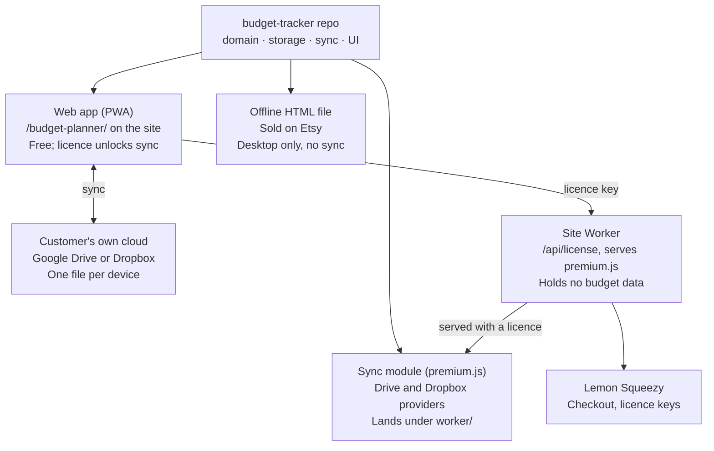

# UK budget app: implementation plan for Claude Code

Plan as of 21 November 2026 · Source doc: https://claude.ai/artifact/AaBFBTxm6tCVDVjMK1sN9H

## Product and goals

We're building a UK-first "safe to spend" budget app, free on alltheboringstuff.co.uk with paid sync, plus an offline file on Etsy, at about £10–13 paid. Its advantage is reliability: it's the one app in the category that never loses data, works on Android, and syncs between devices. The research behind this plan is in [docs/research.md](research.md).

How we stand out, and what each one has to mean in practice:

| Differentiator | The complaint it answers | What it means in the build |
| --- | --- | --- |
| Saving that just works | Safari and Firefox save a new file every time; Android and Samsung users say the app doesn't work; data is lost when the browser is cleared | The hosted app is the main product. It saves automatically after every change, with no Save button. Storage health is shown on screen. Backups take one tap and restore themselves. |
| Simple first setup | "Very hard to navigate"; "not really ADHD friendly"; trouble setting up the calendar | Four onboarding steps lead straight to the safe-to-spend number in under 3 minutes. Advanced pages stay hidden until you switch them on. |
| Sync between devices | Data lives in one browser on one device | Data is stored on the device first and synced through the customer's own Google Drive or Dropbox, so it never reaches our server. Phone and laptop catch up with each other within about a minute. |
| UK angle | Almost every competitor is built around US paychecks | Monthly and 4-weekly pay; payday moves earlier when it lands on a weekend or bank holiday; council tax in 10 instalments; Direct Debits; savings pots; ISA allowance. |

**Success criteria for v1:**

- No data lost in the device test set (see Testing), including after closing the browser, restarting the phone and going offline.
- A new user reaches their safe-to-spend number in under 3 minutes, with no help.
- A change made on a phone appears on a laptop within 2 minutes when both are online and open.
- It works the same in Chrome on Android (including Samsung Internet), Safari on iPhone, and Chrome, Edge, Safari and Firefox on desktop.

## Architecture

The app has its own repo and ships as a free web app at `alltheboringstuff.co.uk/budget-planner/`, plus an offline file for Etsy. A licence unlocks the sync module, which the site's existing Worker serves.



Budget data lives only on the customer's devices and, if they turn on sync, in their own Google Drive or Dropbox. Our server only sees licence keys, so an outage never stops anyone logging a spend. A pull request carries each build into the `decision-tools` repo, and G merges it.

## Tech stack

The app has its own repo and two builds: the web app, which lives on the existing site, and the offline file sold on Etsy. Nothing on our side stores budget data. The only server code is a licence check, added to the site's existing Cloudflare Worker.

| Layer | Choice | Why |
| --- | --- | --- |
| Repo | Own repo, `budget-tracker`, in its own local folder | Sync, IndexedDB, browser tests and two builds would swamp a repo of static calculators |
| Publishing to the site | A GitHub Action in `budget-tracker` opens a pull request on `decision-tools` that updates `site/budget-planner/` and the sync module under `worker/` | Matches the site's rule that automation opens pull requests and G merges |
| Language and build | TypeScript, Vite; `vite-plugin-singlefile` for the offline build | One codebase. The single-file plugin puts all JS and CSS inline, so the offline build is one `.html` file. |
| UI | Preact + Preact Signals | Small bundle and fast on cheap Android phones. Easy for Claude Code to work in. |
| Styling | The site's `DESIGN.md`: Bricolage Grotesque and Hanken Grotesk, teal band, amber buttons, light and dark themes | Looks like the rest of All the Boring Stuff |
| Local storage | IndexedDB via Dexie, with `navigator.storage.persist()` | Stores more than localStorage and is less likely to be cleared. Supports transactions, so a half-finished write can't corrupt data. |
| Offline and install | Service worker and a web app manifest scoped to `/budget-planner/` | Installs to the home screen on Android and iPhone and works with no signal |
| Sync | The customer's own Google Drive (`drive.appdata`) or Dropbox (App folder), using OAuth with PKCE in the browser, behind a `SyncProvider` interface | No budget data on our server. Supabase can be added later behind the same interface. |
| Licences and payments | Lemon Squeezy licence keys, checked by `/api/license` on the `decision-tools` Worker | The same flow as Let or Sell premium. Lemon Squeezy is merchant of record and handles VAT. |
| Hosting | Cloudflare Workers with static assets: the existing `decision-tools` Worker | Free for commercial use. One domain with a folder per tool, so search ranking builds on one site. Vercel's free plan is non-commercial only. |
| Money maths | Integer pence everywhere; dates as ISO `YYYY-MM-DD` strings in UK time | No rounding errors, and no off-by-one days around British Summer Time |
| Tests | Vitest (unit), Playwright (Chromium, WebKit, Firefox, plus Android emulation), mock sync providers | The save/restore promise has to be proven on every browser engine |
| CI | GitHub Actions: lint, typecheck, unit tests, end-to-end tests, both builds, then the publishing pull request | Every change is checked before it reaches the site |

## Differentiator 1: saving that just works

There's no Save button. Every change is written to the device straight away, and the app always shows where the data is kept and how safe it is. Competitors lose data in three ways: Safari and Firefox save a new file each time; HTML files are opened on phones, where they don't work properly; and browser storage gets cleared. The design below closes all three.

**Rules for the storage layer**

1. **Write on every change.** Each edit is one IndexedDB transaction, committed before the screen updates. If the write fails, the screen shows an error and nothing is changed.
2. **Ask for persistent storage** (`navigator.storage.persist()`) on first run and after install. Record whether it was granted.
3. **Show storage health** in a small status chip that's always visible. It has four states:
   - "Saved on this device"
   - "Synced 2 min ago"
   - "Not protected: turn on sync or make a backup" (when persistence is denied and sync is off)
   - "Private window: nothing will be kept" (detected on start)
4. **Take automatic snapshots** inside IndexedDB: one a day for the last 7 days and one a week for 4 weeks. Settings has "Undo a bad day", which restores any snapshot. A snapshot is also taken before every schema change.
5. **Use one backup format:** `budget-backup.json`, which carries a schema version, an export date and a checksum. Restoring checks all three and shows a summary ("412 spends, 18 bills, last change 3 Nov") before replacing anything.
6. **Back up the best way each browser allows:**
   - Chrome and Edge on desktop: link a backup file once with the File System Access API. The app then rewrites that same file after each session; the handle is kept in IndexedDB.
   - iPhone and Android: the share sheet (Web Share API) sends the backup to Files, Google Drive or email.
   - Safari and Firefox on desktop: download with a fixed file name. The restore screen accepts a dragged file and reads the newest one if several are dropped.
7. **Guard against missing data.** A small marker survives in a second store (localStorage plus a cookie). If the database is empty but the marker says data existed, the app doesn't show onboarding. It shows "Your budget seems to be missing", with **Restore from backup** and **Reconnect sync**.
8. **Remind about backups.** If sync is off and the last backup is over 7 days old, show one calm prompt on the Today screen. It can be snoozed and never blocks anything.

**Per platform**

| Platform | Main way to use it | Storage risk | What we do |
| --- | --- | --- | --- |
| Android (Chrome, Samsung Internet) | Hosted app installed to home screen | Low once installed and persisted | Never ask Android users to open an HTML file. The Etsy PDF sends them straight to the hosted app. |
| iPhone and iPad | Hosted app added to home screen | Safari can clear website data after 7 days of no use; home-screen apps are exempt | Onboarding on iOS walks through Add to Home Screen and suggests turning on sync. |
| Desktop Chrome and Edge | Hosted app, or the offline file | Low | Linked backup file, rewritten in place: the fix for the "new file every save" complaint. |
| Desktop Safari and Firefox | Hosted app recommended | File saving can only download a new copy | Steer to the hosted app; fixed-name download for backups. |
| Offline HTML file | Desktop only, for people who don't want an account | Browser storage for local files is shared and fragile | IndexedDB plus the linked backup file in Chrome and Edge. A clear on-screen note that it's for desktop. |

## Differentiator 2: simple first setup

Four steps take a new user from opening the app to their safe-to-spend number in under 3 minutes. Every other feature waits until they ask for it.

**The four steps** (one question per screen, big tap targets, a Back button, progress dots):

1. **When do you get paid?** Choose monthly (a date or "last working day"), every 4 weeks, every 2 weeks or weekly, then enter your next payday and take-home pay. Weekends and bank holidays are handled for you.
2. **What's in your current account now?** One number. An optional line explains why this is the starting point.
3. **What comes out before payday?** A checklist of common UK bills with pre-filled names: rent or mortgage, council tax, energy, water, broadband, mobile, TV licence, car insurance, and streaming. Tick a bill, then enter its amount and day. "Add another" comes last. Nothing is required.
4. **Your number.** The Today screen opens with the safe-to-spend figure and one line explaining it. Tapping "How is this worked out?" shows every figure that went into it.

**Rules that keep it simple**

- **Simple mode is the default.** It shows four tabs: Today, Spend, Bills, Pots. Debt, Calendar, Year and Reports appear only after you turn them on in Settings, and nothing is deleted when you turn them off.
- **Logging a spend takes one line.** Type `coffee 3.40` or tap a quick amount. Categories are suggested from earlier spends.
- **Every screen has an empty state** that says what to do next in one sentence. No blank tables.
- **Hand-holding without pop-up tours:** a "What's this?" link on each screen opens a 3-line explanation.
- **"Try with example numbers"** fills a sample household that can be wiped in one tap. The demo uses the same data.
- **Accessibility from day one:** text resizes to 200%, high contrast in both themes, the whole app works by keyboard, and motion is reduced when the system asks.

**Acceptance test:** five people who have never seen the app each finish setup in under 3 minutes with no help, on a phone. Their time and any place they got stuck are recorded.

## Differentiator 3: sync between devices

Sync goes through the customer's own cloud storage: Google Drive or Dropbox at launch, OneDrive later. Budget data never reaches our server. The app is local-first: it always reads and writes the device's own copy, and sync runs in the background whenever there's a signal.

**Where the data goes**

- **Google Drive:** the hidden app data folder, using the `drive.appdata` scope. Google classes it as non-sensitive, so the app only needs basic verification. The customer can't see or edit the folder by accident.
- **Dropbox:** an "App folder" app, which can only see `/Apps/<app name>/`.
- **OneDrive (later):** the Microsoft Graph app folder (`approot`).
- **Sign-in** is OAuth with PKCE in the browser. Tokens stay in IndexedDB on the device; our server never sees them.

**Data model**

- Every record (spend, bill, pot, payday rule, setting) has:
  - a UUIDv7 `id`
  - a `type`
  - a `data` JSON body
  - an `hlc` timestamp (a hybrid logical clock, so device clock drift can't reorder edits)
  - a `deleted` flag (records are never hard-deleted while syncing)
  - the `device_id` that last changed it
- Each local change also goes into an **outbox** in the same IndexedDB transaction, so a change can't be saved without being queued for sync.
- **One file per device:** each device owns `devices/<device_id>.json` in the cloud folder, holding every record it has changed. Only that device ever writes the file, so two devices can never overwrite each other.
- A small `manifest.json` lists the devices and their names ("G's iPhone").
- **Compaction:** when a device file passes 1 MB, records already replaced by a newer version on another device are dropped from it.

**How a sync runs**

1. **Upload:** if the outbox isn't empty, rewrite this device's file and clear the outbox.
2. **Check:** list the folder and download any other device's file whose revision has changed since it was last seen.
3. **Merge:** for each record, keep the version with the newest `hlc`. Apply the result locally in one IndexedDB transaction. If more than 50 records change, take a snapshot first.
4. **When it runs:** on start, on regaining the network, on returning to the app, 5 seconds after the last local change, and every 2 minutes while the app is open. Without a server sending notifications, changes arrive within about a minute.

**Conflicts:** newest wins per record. Most data is spends, which are added rather than edited, so real conflicts are rare. Settings merge per field rather than per record.

**Connecting a device:** Settings → Sync → **Connect Google Drive** or **Connect Dropbox**. If the folder already holds data from other devices, ask once: **Merge both** (default), **Use this device's budget**, or **Use the cloud copy**. Take a snapshot first, whatever the choice.

**Known limits**

- Google's browser-only sign-in gives short-lived tokens, so Google users may occasionally see "Reconnect Google Drive". It's one tap, and saving carries on locally meanwhile. Dropbox gives browser apps long-lived refresh tokens.
- A couple shares a budget by connecting the same cloud account on each device. Sharing between two separate accounts is a later feature.
- We can't see customers' data, so support works from a backup file the customer sends.

**What the user sees:** the status chip shows "Synced 2 min ago", "Syncing…", "Offline – changes saved on this device", or "Reconnect Google Drive". Settings lists the devices from the manifest, each with a Remove button.

**Later option: Supabase.** We may add or switch to server sync through Supabase at a later date. Reasons to do it would be instant sync, sharing a budget between two separate accounts, or easier support. The data model above is chosen so this needs no migration:

- The same records (UUIDs, HLC timestamps, delete flags, outbox) can sync to a Supabase `records` table protected by row-level security.
- All sync code sits behind a `SyncProvider` interface (`connect`, `push`, `pull`, `disconnect`), so Drive, Dropbox and Supabase can be swapped or used side by side.
- Before taking that step: decide on end-to-end encryption, and finish the ICO and data-protection work, because budget data would then sit on our server.

## UK angle

The app is built around how UK households are actually paid and billed, not converted from a US template. Pay cycles and bill patterns live in the domain engine (Phase 1), so they're correct everywhere.

| Area | What to build |
| --- | --- |
| Pay cycles | Monthly on a fixed date, monthly on the last working day, every 4 weeks (13 paydays a year), fortnightly, weekly. Universal Credit as a monthly payment on a fixed date. |
| Weekends and bank holidays | A payday on a non-working day moves to the working day before, with a per-payday override. Bank holidays come from the GOV.UK feed (`gov.uk/bank-holidays.json`): a copy is bundled for offline use and refreshed when online. The user picks England and Wales, Scotland, or Northern Ireland. |
| Council tax | A preset for 10 monthly instalments, April to January, with an option for 12. February and March show as "no council tax" months, which lifts safe to spend. |
| Bill language | Direct Debit, standing order, card payment. Bill presets for UK suppliers by category, with no brand names needed. |
| Yearly costs | Sinking-fund presets: car tax, MOT and service, TV licence, home and car insurance, Christmas, birthdays. Each saves a monthly share automatically. |
| Pots | Savings are called "pots", like Monzo and Starling. An ISA allowance tracker runs over the tax year (6 April to 5 April); the allowance is a setting, so a change in the limit doesn't need an app update. |
| Borrowing | Credit cards, loans, and buy now, pay later plans (Klarna, Clearpay, PayPal Pay in 3) as instalment plans whose payments land on their real dates. An arranged overdraft is optional: "count my overdraft in safe to spend" is off by default. |
| Formats | `en-GB` throughout: £, dd/mm/yyyy, Monday-start weeks, UK spelling. |
| Bank CSV import (Phase 2) | Ready-made column maps for Monzo, Starling, Barclays, HSBC, Lloyds, NatWest, Nationwide and Santander exports, plus a manual column picker for any other bank. |

## Core features at parity with the market

v1 matches what buyers already expect, and no more; the effort goes into the differentiators. Anything marked Later waits until v1 has reviews.

**The safe-to-spend calculation** (Phase 1; every screen depends on it):

```text
left_until_payday = current_balance
                  − unpaid bills due on or before the next payday
                  − pot and sinking-fund contributions due before the next payday
                  − buffer (user setting, default £0)
                  + arranged overdraft (only if switched on)
safe_today        = left_until_payday ÷ days until payday (counting today)
```

Spending less today raises tomorrow's figure; overspending spreads the shortfall across the remaining days. "How is this worked out?" shows each line with its amount.

| Feature | v1 | Notes |
| --- | --- | --- |
| Today: safe to spend, days to payday, next 3 bills | v1 | The home screen |
| Quick spend logging, editable categories | v1 | One line (`coffee 3.40`), undo |
| Bills and Direct Debits, with recurrence rules | v1 | Weekly, fortnightly, 4-weekly, monthly, quarterly, yearly, 10-instalment |
| Payday view: which bills each payday covers | v1 | Flags months with 3 fortnightly or 5 weekly paydays |
| Pots and sinking funds | v1 | Target, date, monthly share, progress |
| Bills calendar | v1 (advanced) | Month grid; tap a day to add |
| Debt payoff: snowball, avalanche, own order | v1 (advanced) | Debt-free date, interest saved by overpaying |
| Month review: planned vs actual by category | v1 (advanced) | |
| Backup, restore, snapshots | v1 | See Differentiator 1 |
| Light and dark themes | v1 | Two themes, done well |
| Bank CSV import | Later | UK bank presets |
| Net worth, investment forecast, no-spend challenges | Later | Only if reviews ask for them |
| Bank connection (Open Banking) | Not planned | It's regulated, and "no bank login" is a selling point |

## Licensing, sales and Etsy

The app lives at `alltheboringstuff.co.uk/budget-planner/`. It's free to use with data on the device only. A Lemon Squeezy licence unlocks sync, exactly like the Let or Sell premium tier. Etsy sells only the offline HTML file, because Etsy prohibits selling access to software or app memberships.

| Product | Where it's sold | What the buyer gets |
| --- | --- | --- |
| Free budget planner | `alltheboringstuff.co.uk/budget-planner/` | The full app, installable, with data on the device and backups to a file |
| Sync licence | The same page, via Lemon Squeezy checkout | A licence key that unlocks sync through Google Drive or Dropbox, plus the offline file |
| Offline file | Etsy, as a digital download | One HTML file and a PDF guide. Desktop only, no sync. |

Etsy listings must never steer buyers to buy again off Etsy; Etsy's fee-avoidance rules forbid it.

**Unlocking sync** (the same flow as Let or Sell premium; see the `decision-tools` `CLAUDE.md`)

1. The customer taps **Unlock sync** in Settings, and the Lemon Squeezy overlay checkout opens.
2. The licence key appears on screen and arrives by email.
3. The app sends the key to `/api/license` on the `decision-tools` Worker. The Worker checks it with the Lemon Squeezy License API and returns a signed token (Ed25519) that names the features and an expiry date.
4. The app stores the token on the device and checks its signature offline against a built-in public key. It re-checks online every 30 days.
5. On a new device the customer enters the key again. Set the activation limit per key in Lemon Squeezy (3 devices suggested).

**Premium code comes from the server.** This is rule 1 in the site's `CLAUDE.md`. The sync module (`/budget-planner/premium.js`) lives under `worker/`, never `site/`. The Worker serves it only to a valid token, using the existing `run_worker_first` route for `/*/premium.js`.

**Refunds:** Lemon Squeezy disables the key. At the next 30-day check, sync stops. The customer's data stays on their devices and in their own cloud.

**The Etsy offline file** is built by `build:offline`: the same app without sync and with no licence check, because the file itself is the product. Sharing the file is possible, and we accept that.

**Our server never holds budget data.** The Worker only sees licence keys and tokens. This is a real selling point ("your budget never touches our servers"), and it keeps the data-protection load small. The site's pre-revenue gate still applies: no paid product until the ICO registration, terms of sale and full privacy notice are done.

## Build phases

There are nine phases. Each ends with tests passing in CI, and none starts until the previous phase meets its acceptance criteria. Storage (Phase 2) comes before the UI, so the reliability promise is built in rather than added at the end.

0. **Scaffold.**
   - Build: the `budget-tracker` repo; Vite with two targets (`web`, `offline`) plus the sync module bundle; ESLint, Prettier, Vitest, Playwright, GitHub Actions; `CLAUDE.md`.
   - Done when: `npm run build` produces `dist/web/`, one file `dist/offline/budget.html` and `dist/premium/premium.js`, and CI is green on an empty app.
1. **Domain engine.** Pure TypeScript with no UI and no storage.
   - Build: money in pence; UK date helpers; recurrence rules (all the UK cycles); bank-holiday shifting; payday generation; safe-to-spend with its breakdown; debt snowball and avalanche.
   - Done when: 100% branch coverage in `src/domain`; table tests for every pay cycle across 2026–2028, including bank holidays, the BST change and leap years.
2. **Storage layer.**
   - Build: Dexie schema with the sync-ready record shape (`id`, `hlc`, `deleted`, `device_id`, outbox); a repository API; write-on-change; `persist()`; storage health state; snapshots; the backup format with checksum; the File System Access linked file; share-sheet and download fallbacks; the missing-data guard; schema migrations.
   - Done when: the save/restore tests (Testing section) pass in Chromium, WebKit and Firefox.
3. **Core UI and onboarding.**
   - Build: the Today, Spend, Bills, Pots and Settings screens; the four-step setup; simple and advanced modes; empty states; "How is this worked out?"; both themes from the site's `DESIGN.md`.
   - Done when: Playwright drives setup to the safe-to-spend number on a phone viewport; axe-core reports no serious accessibility issues.
4. **Advanced screens.**
   - Build: Calendar, Payday view, Debt, Month review.
   - Done when: every advanced screen has an empty state and passes the same accessibility check.
5. **Installable web app on the site.**
   - Build: a manifest scoped to `/budget-planner/`; service worker; iOS Add to Home Screen guide; a GitHub Action that opens a pull request on `decision-tools` with `site/budget-planner/`; a card in the home page's Calculators section.
   - Done when: Lighthouse marks it installable; it opens and saves in airplane mode on Android and iPhone; the pull request works under `wrangler dev`.
6. **Sync through the customer's cloud.**
   - Build: the `SyncProvider` interface; Google Drive (`drive.appdata`) and Dropbox (App folder) providers with OAuth PKCE; per-device files; manifest; merge; compaction; the connect flow; the status chip.
   - Done when: the sync tests pass against the mock provider and against real Drive and Dropbox test accounts.
7. **Licensing and the Etsy file.**
   - Build: the Lemon Squeezy product; `/api/license` on the `decision-tools` Worker (shared with Let or Sell premium); signed tokens; the Worker serving `premium.js` only with a valid token; the 30-day re-check; the offline build for Etsy.
   - Done when: a test purchase unlocks sync; a refunded key stops sync at the next check; `premium.js` returns 401 without a licence.
8. **Launch kit.**
   - Build: the page copy for `/budget-planner/`, help pages, the Etsy listing and PDF guide for the offline file, Google and Dropbox app verification.
   - Done when: the site's pre-revenue gate is cleared (ICO registration, terms of sale, full privacy notice) and a test buyer gets from the page to a synced second device in under 5 minutes.

## Testing

The save and sync tests below *are* the product promise. They run in CI on every pull request, and a failure blocks the merge.

**Save and restore (Phase 2)**, in Chromium, WebKit and Firefox:

- [ ] Add 500 spends, reload: all 500 are there.
- [ ] Close the context in the middle of a write: after reopening, the data is either before or after that write, never corrupted.
- [ ] Export a backup, clear site data, restore: the record count and checksum match.
- [ ] Clear site data with the marker kept: the app shows "Your budget seems to be missing", not onboarding.
- [ ] Restoring a file from an older schema version migrates it correctly.
- [ ] Restoring a corrupted or edited file is refused with a clear message, and current data is untouched.
- [ ] Restore a snapshot from 3 days ago: data matches that day.
- [ ] Chromium only: the linked backup file is rewritten in place, so its file name doesn't change.

**Sync (Phase 6)**, against an in-memory mock provider, plus real Google Drive and Dropbox test accounts:

- [ ] Device A adds a spend; device B shows it after its next sync, within 2 minutes while open.
- [ ] Both devices go offline, each edits the same bill, then reconnect: both end with the newer edit, and nothing is duplicated.
- [ ] A device only ever writes its own file (checked on the provider's calls).
- [ ] Uploading the same device file twice changes nothing.
- [ ] Connecting to a folder that already holds data works for all three choices, with a snapshot before each.
- [ ] An expired Google token shows "Reconnect Google Drive"; saving carries on locally and catches up after reconnecting.
- [ ] No request carrying budget data goes to `alltheboringstuff.co.uk` (a network check in Playwright).

**Real devices before launch** (by hand, using a checklist in the repo):

| Device | Browser | Install | Offline save | Sync | Backup |
| --- | --- | --- | --- | --- | --- |
| Android (Samsung) | Samsung Internet | ☐ | ☐ | ☐ | ☐ |
| Android (Pixel or other) | Chrome | ☐ | ☐ | ☐ | ☐ |
| iPhone | Safari, home screen | ☐ | ☐ | ☐ | ☐ |
| iPad | Safari | ☐ | ☐ | ☐ | ☐ |
| Windows | Chrome, Edge, Firefox | ☐ | ☐ | ☐ | ☐ |
| Mac | Safari, Chrome | ☐ | ☐ | ☐ | ☐ |
| Offline HTML file | Chrome on Windows, Safari on Mac | n/a | ☐ | n/a | ☐ |

## Working with Claude Code

This plan is `docs/PLAN.md` and the project instructions are `CLAUDE.md` at the repo root. Run one phase per session, using the prompts below, and review the pull request before starting the next.

**Prompts, one per session**

0. "Read docs/PLAN.md and CLAUDE.md. Do Phase 0: scaffold the repo, the two Vite targets, the sync module bundle and CI. Stop when `npm run build` produces all three outputs and CI is green."
1. "Do Phase 1, the domain engine. Write table tests first for every UK pay cycle from 2026 to 2028, including bank holidays and BST, then implement. Use the GOV.UK bank-holidays JSON as a bundled fixture."
2. "Do Phase 2, the storage layer, with the sync-ready record shape. Start with the save and restore tests in docs/PLAN.md, run them in Chromium, WebKit and Firefox, then build until they all pass. Show me the storage health states in a bare test page."
3. "Do Phase 3: the core screens and the four-step setup in simple mode, styled to decision-tools' DESIGN.md. Use the domain and storage layers only through their public APIs. Add a Playwright test that completes setup on a 390×844 viewport."
4. "Do Phase 4: the advanced screens behind the advanced toggle."
5. "Do Phase 5: make the web build installable under /budget-planner/ and working offline, and add the GitHub Action that opens a pull request on decision-tools with the build and a home page card."
6. "Do Phase 6: the SyncProvider interface and the Google Drive and Dropbox providers. Write the sync tests first against an in-memory mock provider."
7. "Do Phase 7: `/api/license` on the decision-tools Worker using the Lemon Squeezy License API, signed tokens, serving premium.js only with a valid token, and the Etsy offline build. Mock Lemon Squeezy in tests."
8. "Do Phase 8: the /budget-planner/ page copy, help pages, and the Etsy listing text and PDF guide for the offline file."

## Open questions

- [ ] **Product name.** The page is `/budget-planner/`; the product name shown in the app and on Etsy is still open.
- [ ] **Price of the sync licence,** and 12 months of access versus lifetime. This is the same open question as for the site's other premium tiers.
- [ ] **Google and Dropbox app verification.** Both need a privacy policy and the verified domain before they're opened to the public. Allow time in Phase 8.
- [ ] **When to add Supabase.** Possible triggers: customers asking for instant sync or for sharing between two separate accounts, or support load from cloud sign-in problems. If we add it, decide on end-to-end encryption first.
- [ ] **Offline file on Etsy in v1 or later?** It's the only Etsy product, but it could wait for v1.1 if Phase 7 runs long.
- [ ] **OneDrive.** Add as a third provider if buyers ask for it.
